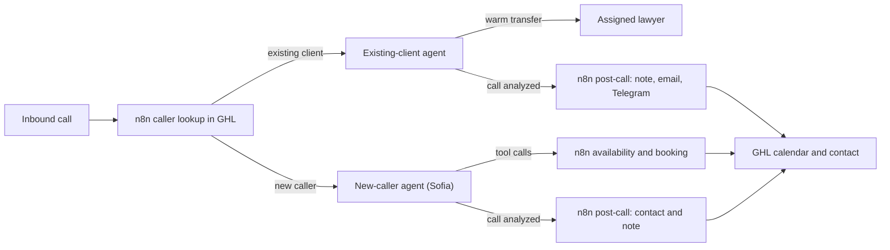

# Rodriguez & Martinez Law: Inbound Voice Agents

Two inbound AI voice agents for a Florida personal injury law firm. One qualifies new callers and books consultations. The other recognizes existing clients and transfers them to their lawyer. Built on Retell AI, n8n and GoHighLevel.

## What it does

- Every inbound call first hits an n8n webhook that looks the caller up in GoHighLevel (GHL) by phone number.
- **Existing clients** (a contact tagged `existing client`) go to the existing-client agent. It greets them by name and offers a warm transfer to their assigned lawyer.
- **New callers** go to the new-caller agent, "Sofia". She takes the accident details, checks whether the case qualifies, and books a consultation on the firm's calendar.
- After each call, n8n updates GHL and alerts the firm when an existing client needs a callback.

## How it works



## What's in this repo

```
agents/    Retell agent configs (new caller, existing client)
prompts/   Full prompts for both agents
n8n/       The n8n workflow: four flows on one canvas
```

The four n8n flows are the inbound caller lookup, availability and booking, the new-caller post-call report, and the existing-client post-call report.

## Stack

| Layer | Tool |
|---|---|
| Voice agents | Retell AI (gpt-4.1, ElevenLabs voice) |
| Orchestration | n8n |
| CRM and calendar | GoHighLevel |
| Knowledge base | Google Docs, passed in by n8n |
| Alerts | Gmail, Telegram |

## The two agents

**New-caller agent (Sofia)**
- Tools: `check_availability`, `book_appointment`, `end_call`.
- Qualifies against the firm's rules, for example it disqualifies workers' comp, medical malpractice and criminal cases, accidents outside Florida, and claims older than the four-year limit.
- Post-call analysis captures 14 fields, including name, email, accident type, date and location, doctor visit, at-fault party, police report and insurance contact.

**Existing-client agent**
- One job: greet the client by name and transfer them to their assigned lawyer.
- Tools: `transfer_to_lawyer` (a warm transfer that briefs the lawyer first) and `end_call`.
- Post-call analysis captures three fields: `call_transferred`, `urgent` and `reason_for_calling`.

## Key design decisions

- **Route before the call starts.** The lookup returns the right agent ID and its dynamic variables to Retell, so a known client never hears the new-caller script.
- **Statute of limitations computed in n8n.** The lookup works out the date four years ago and passes it to the agent in plain words, so the agent can tell when an accident is too old without doing date math.
- **Knowledge base passed per call.** The firm's FAQ lives in a Google Doc. n8n reads it during the lookup and sends it to the agent as a dynamic variable, so the firm edits the doc without touching the agent.
- **Lawyer name from the CRM.** The assigned lawyer comes from the GHL contact, so the transfer always goes to the right person.
- **Alerts only when a person must act.** For existing clients, every call gets a CRM note. An urgent call where the transfer failed sends an urgent email and a Telegram message. A non-urgent failed transfer sends a callback email. A completed transfer sends no alert.

## Placeholders

| Placeholder | Replace with |
|---|---|
| `your-n8n-instance.example.com` | Your n8n base URL |
| `YOUR_WEBHOOK_PATH` | The webhook paths you choose |
| `YOUR_GHL_LOCATION_ID` | Your GHL location ID |
| `YOUR_GHL_CALENDAR_ID` | Your GHL calendar ID |
| `YOUR_GHL_USER_ID_2`, `YOUR_GHL_USER_ID_3`, `YOUR_GHL_USER_ID_4` | Your GHL staff user IDs |
| `YOUR_RETELL_EXISTING_CLIENT_AGENT_ID` | Your Retell existing-client agent ID |
| `YOUR_RETELL_NEW_CALLER_AGENT_ID` | Your Retell new-caller agent ID |
| `YOUR_KNOWLEDGE_BASE_DOC_ID` | Your knowledge-base Google Doc ID |
| `YOUR_TELEGRAM_CHAT_ID` | The Telegram chat that gets urgent alerts |
| `user@example.com` | The firm's alert email address |

## License

All rights reserved. Published for viewing only. See [LICENSE](LICENSE).
